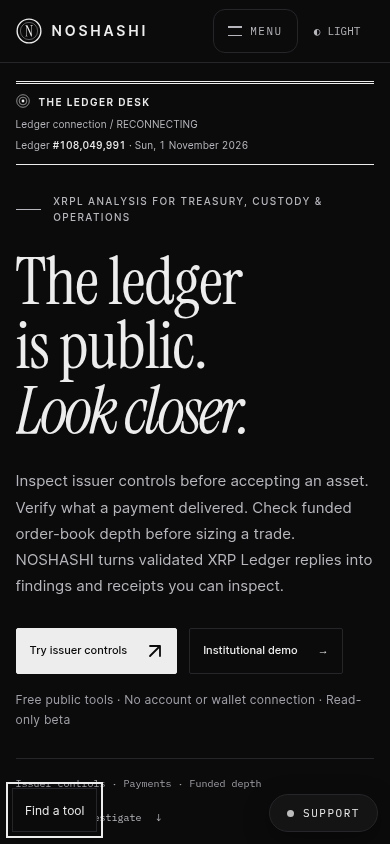
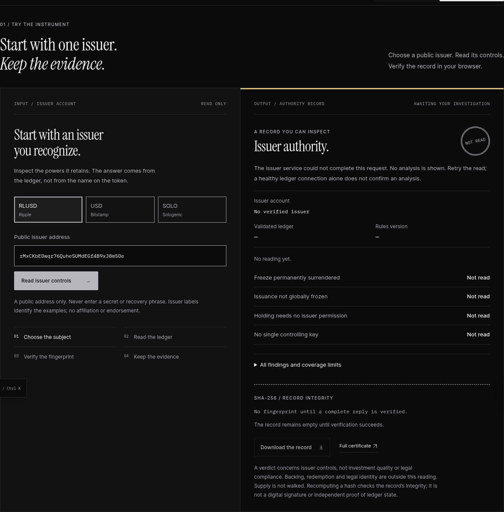

# First investigation: implementation and verification

Reviewed against main `4a15dc9` on 1 November 2026. No AGENTS.md was present in the repository or its ancestors. Production was inspected read-only; these changes are for pull-request review, not production deployment.

## Architecture and confirmed failures

`scripts/build-site.mjs` renders `templates/home.html` and supporting pages into `site/`. Vercel serves that output and routes public API functions and rewrites from `vercel.json`. The browser workspace and institutional issuer demo use `/api/issuer-state`; homepage investigations and standalone certificates use `/api/authority`. These responses answer different questions and do not share a receipt scope.

The production homepage returned **NOT READ twice for RLUSD**. The recorded response in `tests/fixtures/authority-rlusd-108049990.json` has five findings and a valid SHA-256 digest. Rule version 2 emits `NO_TRANSFER_FEE` only for a positive fee; the homepage incorrectly required that finding for every issuer. Independent recomputation matched the server digest. The fix accepts the documented conditional schema, never inserts a synthetic finding, and still hashes the exact returned canonical payload. Removing a fee finding from another receipt without changing its digest still fails verification.

The comparison table completed during this review, so indefinite loading was not reproduced as an upstream failure. Its code did have unbounded fetches, viewport-only initialization, no retry, no response-status check, and no receipt verification. It now starts explicitly, bounds each request and body read to 20 seconds, verifies each row, and provides row and table retries. Each row retains its own issuer, ledger, rule version and downloadable exact receipt; a maximum ledger is not described as a shared snapshot.

One observed edge reply was `STALE` with Age 2709 seconds. Cached and stale readings are labelled with their recorded timestamp. Successful caching retains its existing policy; unreadable records and errors are no-store. A connected ledger feed is kept separate from successful analysis. The public API now derives controls and posture from one validated account_info snapshot instead of two independently moving validated reads. Missing signer information cannot silently become an established finding.

## Verification

- `npm test -- --maxWorkers=4`: **1,511 passed, 4 skipped**. Includes source snapshot, error caching, real five/six-finding fixtures, canonical integrity, unsupported schemas, invalid/incomplete/unavailable replies, cancellation, stalled request/body deadlines, and cache provenance.
- `npm run build`, root TypeScript, Academy and NOSHREPAIR typechecks; NOSHREPAIR production build.
- Public website, NOSHX and Academy builds; generated garden, intelligence, brand and bloom checks. Generated help bundles are rebuilt because they embed the changed public documentation.
- `scripts/verify-first-investigation.mjs`: dark, paper, mobile, reduced-motion and no-JavaScript browser cases. Tests actual 20-second request and comparison deadlines, retries, late replies after subject change, exact JSON downloads, keyboard dialogs, navigation and overflow.
- Real browser reads through local API handlers: homepage RLUSD, all six comparison issuers, institutional issuer/payment/liquidity scenarios, workspace issuer analysis and standalone certificate. All returned results; no fixture or production API substitution was used for this smoke test. Production versions of the existing flows were also checked before editing.
- No email, contact, checkout or pilot form was submitted. There is no new dependency or change to prices, grants or billing behavior.

The local test runner initially lacked loopback networking for its existing HTTP transport tests; those tests and the complete suite passed when run with network access. There is no lint script in package.json. Deno is not installed in this workspace; the unchanged Edge Function typecheck remains in repository CI.

## Scope and limitations

Receipts check canonical SHA-256 payload integrity, not publisher identity, validator signatures, or independent ledger proofs. Public nodes remain trusted sources. Cached reads are not monitoring. A no-walk homepage reading explicitly abstains on concentration; the optional standalone holder survey retains its separate existing bounded source/read scope. Unsupported rule versions fail closed.

The homepage keeps the existing graphite/paper palette, editorial type and restrained explanatory geometry. Repeated explanations and duplicate tools are removed; supporting routes and navigation remain. Prices and contractual definitions are unchanged. Current beta, unsigned OS installers, planned SSO/SLAs/dedicated environments and absent independent assessment are made explicit; see [the source-based claims review](website-first-use-claims.md).

## Screenshots

Browser regression screenshots use labelled, recorded ledger fixtures, not invented live results. Full-page and real-data captures remain in the execution artifacts; the review samples below cover desktop, mobile and the unavailable state.

